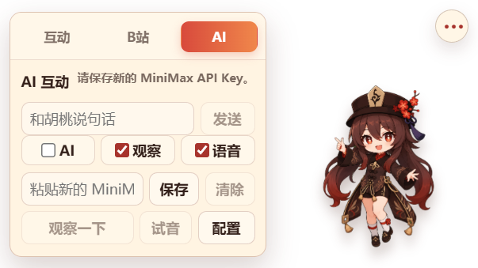

# 胡桃桌宠 · Hu Tao Desktop Pet

[](https://github.com/iotyunhe/Desktop-Pet-Hutao/actions/workflows/ci.yml)
[](LICENSE)
[](#)
[](https://www.electronjs.org/)

一个 Windows 优先的 2D Electron 桌宠：透明置顶、拖拽漫步、点击反应、温柔养成、MiniMax AI 对话，以及 **自己定时去 B 站逛、把好看好玩的内容分享给你** 的「B 站漫游」。桌宠现有 25 个动作状态，其中 12 个是新增的「撑伞、放灯、扮鬼、画符、递茶」等形象。

> 这是本地运行的非商业 fan-art 项目，与 HoYoverse 无关。《原神》与胡桃角色版权归 HoYoverse 所有。

## 界面预览

互动面板改成「互动 / B站 / AI」三个标签页，操作和配置不再堆在一条长列表里：

| 互动 | B站 | AI |
| --- | --- | --- |
|  |  |  |

B 站分享卡：


12 个新动作（全部在真实 Electron 窗口里逐个截图）：


## 快速开始

```powershell
git clone https://github.com/iotyunhe/Desktop-Pet-Hutao.git
cd Desktop-Pet-Hutao
npm install
npm run dev        # 开发模式
npm run dist       # 打包：安装版 exe + 便携版 exe
```

构建产物在 `release/`：

- `HuTao-Desktop-Pet-Setup-0.4.1-x64.exe`：NSIS 安装包。
- `HuTao-Desktop-Pet-0.4.1-portable.exe`：免安装便携版。
- `win-unpacked/胡桃桌宠.exe`：未压缩目录版，方便调试。

> 打包会写入应用图标与版本信息，electron-builder 首次需要下载 `winCodeSign`。如果它在无管理员权限的机器上解压失败，可用管理员权限运行一次，或把 `winCodeSign-2.6.0.7z` 解压到 `%LOCALAPPDATA%\electron-builder\Cache\winCodeSign\winCodeSign-2.6.0` 后重试（只需 Windows 部分，darwin 软链接报错可以忽略）。安装包没有代码签名，首次运行可能触发 SmartScreen，选择「仍要运行」即可。

## 功能

### 桌宠本体

- 透明无边框窗口，默认出现在主屏右下角，始终置顶。
- 左键拖拽移动并保存位置；单击触发开心/好奇反应；**长按只拖拽，不会弹气泡、不会把窗口撑大**。
- 75 秒无交互进入睡觉状态，点击唤醒。
- 自由漫步：每 30–54 秒随机小幅移动，左右使用独立步行动作，自动避开屏幕边界。
- 空白区域鼠标穿透，只有胡桃本体、菜单按钮和面板可交互。
- 托盘菜单：显示/隐藏、置顶、漫步、开机自启、缩放、重置位置、去 B 站逛一圈、B 站自动分享、退出。
- 设置持久化到 Electron `userData/settings.json`。

### 互动面板

- 三个标签页：**互动 / B站 / AI**，每个标签独立滚动，不再把养成操作和接口配置混在一起。
- 互动：亲密度/等级/心情/精力、摸头、休息、每日补给、茶点与礼物。
- B站：自动逛站开关、免打扰、AI 文案、去逛逛、打开 B 站、最近分享；偏好设置折叠在「偏好设置」里。
- AI：聊天、AI/观察/语音开关、API Key、观察一下、试音；模型与接口配置折叠在「配置」里。
- 分享卡仍然独立展开，不会挤占面板。
- 面板/分享卡关闭、或渲染层与主进程失同步时，会自动把窗口收回桌宠尺寸，不会留下「宽窗口 + 远处菜单按钮」的残局。

### 温柔养成

- 亲密度、等级、心情、精力、背包、每日补给与等级解锁奖励。
- 摸头、喂食、送礼、休息；不互动不会掉亲密度，也没有惩罚。
- 养成档案保存在 `userData/profile.json`。

### AI 互动（可选）

- MiniMax 文本对话、TTS 语音回复、小聊天输入框、低频活动窗口观察。
- 只读取当前活动应用名与窗口标题，不截图、不 OCR、不采集画面。
- API Key 通过 Electron `safeStorage` 加密保存在 `userData/minimax-api-key.bin`，不会进入仓库。

### B 站漫游

胡桃会按你设置的节奏，自己「出门」去 B 站逛一圈，挑一条内容，然后回来给你分享：

1. **自动逛站**：默认每 75 分钟一次（15–360 分钟可调，带 ±25% 随机抖动），每天最多 8 条。
2. **手动逛站**：互动面板里点「去逛逛」，或托盘菜单「去 B 站逛一圈」。
3. **内容来源**：匿名调用 B 站公开接口——热门、排行榜、游戏/科技分区最新投稿，四个来源并行抓取后按 `bvid` 去重。
4. **内容筛选**：
   - 排除广告、带货、恰饭、恐怖、引战、网暴等关键词；
   - 默认只看 45 秒–20 分钟的视频（可在配置里放开到 60 分钟）；
   - 过滤低播放、看过、点踩过的稿件和 UP 主；
   - 按兴趣关键词、分区喜好、播放量、新鲜度打分，并在候选前列做偏置随机，避免每次都是同一条热门。
5. **分享卡片**：封面、标题、UP 主、时长、播放量、推荐理由，以及「去 B 站看看 / 复制链接 / 换一个 / 不感兴趣 / 喜欢这类」。
6. **不打扰**：
   - 安静时段（默认 00:30–07:30）不自动分享；
   - 你正在看面板时，只在气泡里提示并亮起小红点，不抢面板；
   - 点「不感兴趣」会记住这个稿件和 UP 主，后续推荐自动避开。
7. **AI 文案（可选）**：配置 MiniMax 后，胡桃会根据标题/分区/播放量现写一句推荐语；没配置或请求失败时自动回退到本地模板文案，功能不依赖 API Key。
8. **隐私边界**：不上传任何本地数据；请求只带 B 站公开接口必需的 User-Agent/Referer；封面由主进程下载为 data URL 后展示，渲染层不会直接访问外部图片。

### 新动作立绘

| 动作 | 触发 |
| --- | --- |
| 撑伞漫步（左/右） | 自由漫步时 25% 概率替换普通走路 |
| 放灯许愿 | 傍晚空闲随机；或送出「小灯」礼物后 |
| 画符 | 空闲随机（白天也有机会） |
| 抱膝打盹 | 睡觉时 45% 概率替代趴桌睡 |
| 炸毛护发型 | 10 秒内连续摸头 3 次 |
| 递茶 | 连续使用 45 分钟后；之后每 90 分钟一次 |
| 扮鬼吓人（鬼脸→偷笑） | 夜间空闲随机；夜间点击 8% 概率 |
| 转圈庆祝 | 升级/解锁新互动；B 站分享点「喜欢这类」 |
| 拨算盘 | 领取每日补给后 |
| 伸懒腰 | 从睡觉状态被点击唤醒时 |

素材处理脚本会做绿幕抠图、去水印、脚底 baseline 对齐和棋盘格预览：

```powershell
python scripts/process-action-sprites.py
```

## 项目结构

```
src/
  shared/                      # 主进程与渲染进程共享的契约（纯 TS，可单测）
    pet.ts                     # 窗口/缩放/面板类型与默认值
    care.ts                    # 养成类型、道具、奖励等级
    ai.ts                      # AI 设置与回复类型
    bilibili.ts                # B 站设置/分享类型 + 安静时段纯函数
    normalize.ts               # 所有持久化数据的归一化（脏数据收口）
    format.ts                  # 播放量/时长/截断格式化
    ipc.ts                     # IPC 通道常量 + 渲染层可见的 HuTaoPetApi
  main/
    index.ts                   # 启动编排、单实例、冒烟测试入口
    smoke.ts                   # 打包后窗口冒烟测试 + 长按回归探针
    ipc/register-ipc.ts        # 全部 IPC handler 与入参校验
    window/
      window-manager.ts        # 透明窗口、拖拽、漫步位移、缩放、面板几何与尺寸上限
      tray.ts                  # 托盘菜单
      assets.ts                # 开发/打包两种图标路径解析
    storage/
      json-store.ts            # 原子写 JSON（tmp + rename）持久化
      settings-store.ts        # settings.json
      profile-store.ts         # profile.json
      ai-store.ts              # ai-settings.json + safeStorage Key
      bilibili-store.ts        # B 站设置与历史
      bilibili-history.ts      # 历史结构、归一化与容量限制
    services/
      care-service.ts          # 养成逻辑
      ai/
        minimax-client.ts      # HTTP + 响应解析（可注入 fetch 测试）
        ai-service.ts          # 对话/观察/试音/B 站推荐语
        desktop-observer.ts    # active-win 低频观察与去重
      bilibili/
        bilibili-client.ts     # 公开接口抓取、封面下载
        video.ts               # 稿件归一化、URL 白名单（纯函数）
        content-curator.ts     # 关键词过滤、打分、偏置随机（纯函数）
        share-composer.ts      # 分享文案模板（纯函数）
        bilibili-service.ts    # 浏览流程、历史、反馈、定时器、安静时段
    util/                      # 日志、时间、定时器
  preload/index.ts             # contextBridge 暴露类型化 API
  renderer/
    index.html
    src/
      main.ts                  # 挂载 UI、绑定事件与主进程推送
      actions.ts               # 面板事件委托（含标签切换）
      api.ts / state.ts / dom.ts / constants.ts / sprites.ts / settings.ts
      modules/
        mood.ts bubble.ts voice.ts lines.ts   # 表情、气泡、语音、台词
        roam.ts interactions.ts drag.ts        # 漫步、点击、长按/拖拽
        gestures.ts action-rules.ts            # 新动作播放与触发规则
        care.ts ai.ts bilibili.ts              # 三个功能域
        panel.ts panel-views.ts                # 标签面板与分享卡
        passthrough.ts                         # 鼠标穿透（去重，仅状态变化时 IPC）
      styles/                  # base / pet / panel / bilibili
tests/                         # node:test 单元测试（esbuild 打包后运行）
scripts/                       # 构建、打包、冒烟测试、图标与立绘处理
resources/                     # 托盘与应用图标（由立绘生成）
docs/                          # 设计文档、截图、动作原图
```

## 常用命令

```powershell
npm run dev        # 开发模式（Electron + Vite HMR）
npm run typecheck  # 主进程 + 渲染进程类型检查
npm test           # node:test 单元测试（内容筛选/文案/归一化/安静时段/持久化/服务流程）
npm run build      # typecheck + 生产构建到 out/
npm run dist       # 构建并打包 NSIS 安装版 + portable 便携版
npm run smoke      # 用仓库内 Electron 跑窗口冒烟测试（含长按回归）
npm run smoke -- --bilibili                                    # 额外抓一条 B 站视频验证网络
node scripts/run-smoke.cjs --capture tmp/care.png --capture-tab=care
node scripts/run-smoke.cjs --capture tmp/ai.png --capture-tab=ai
node scripts/run-smoke.cjs --capture tmp/boo.png --capture-mood=boo
node scripts/run-smoke.cjs --exe "release/win-unpacked/胡桃桌宠.exe"  # 验证打包后的 exe
```

冒烟测试会使用临时 `userData`，不会污染真实存档；结果写入 `--smoke-result` 指定的 JSON 并打印到终端。检查项包括：窗口创建、renderer 挂载、preload 桥接、透明背景、B 站 IPC、存档落盘、托盘/应用图标、长按窗口尺寸与气泡收起。

图标和动作素材可以重新生成（需要 Pillow）：

```powershell
python scripts/generate-icons.py
python scripts/process-action-sprites.py
```

## 数据与隐私

| 文件 | 内容 |
| --- | --- |
| `userData/settings.json` | 窗口位置、缩放、置顶、漫步、开机自启 |
| `userData/profile.json` | 亲密度、等级、背包、每日补给、解锁奖励 |
| `userData/ai-settings.json` | MiniMax 接口、模型、人设、观察间隔 |
| `userData/minimax-api-key.bin` | `safeStorage` 加密后的 API Key |
| `userData/bilibili-settings.json` | B 站漫游开关、间隔、安静时段、兴趣关键词 |
| `userData/bilibili-history.json` | 看过的稿件、分享记录、喜欢/不感兴趣的 UP 主 |
| `userData/logs/app.log` | 运行日志（超过 1MB 自动轮转） |

- 桌面观察只读取当前应用名与窗口标题。
- B 站分享只把视频标题/UP 主/分区/播放量交给 AI 生成文案，不上传本地文件。
- 不截图、不 OCR、不监听麦克风、不读取剪贴板（除非你点「复制链接」）。

## 已知边界

- B 站公开接口可能限流或改版；失败时只提示一句，不阻塞桌宠本体，并在 10–25 分钟后重试。
- 未做登录态 WBI 签名，因此不使用搜索接口，只从热门/排行/分区新稿里挑。
- 仅针对 Windows x64 打包；代码保留 macOS/Linux 的 Electron 兼容路径，但未验证。
- 安装包未做代码签名，首次运行可能触发 SmartScreen。

## 参与贡献

- 开发、测试、素材规范和提交约定见 [CONTRIBUTING.md](CONTRIBUTING.md)。
- 安全问题请走 [SECURITY.md](SECURITY.md)，不要在公开 Issue 贴 Key 或用户存档。
- 版本变化见 [CHANGELOG.md](CHANGELOG.md)。

## License

代码使用 [MIT License](LICENSE)。

《原神》与胡桃角色版权归 HoYoverse 所有；本项目是非商业 fan-art，与官方无关。`src/renderer/assets/pet/` 中的立绘为本地生成的角色二创素材，请勿用于商业用途。
